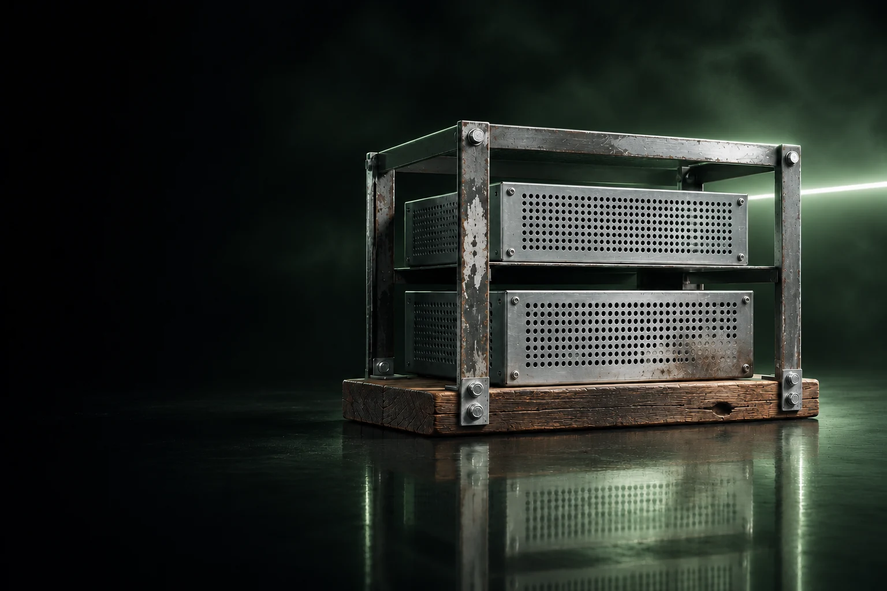

# 归塑 ReForm

**让旧材料成为新设计的起点。** 归塑面向循环设计师、校园创客与小型再造工坊，围绕 Hack4Good 环保议题，探索如何从废旧材料档案出发，形成可核对的再造方案、制作资料和反馈记录。



[首页源码](index.html) · [五步工作台](workbench/index.html) · [项目规划书](docs/project-plan.html) · [原始规划说明](docs/project-plan.md)

## 项目与当前能力

旧材料的形态、尺寸、状态和数量各不相同。归塑用同一组示例材料串联**材料护照 → 库存与约束 → 预设设计方案 → 装配预演 → 产品档案**。工作台中的缺口和档案内容根据当前库存实时计算。材料、方案和处置记录的关联，方便团队后续补录实测、试制、返工和材料去向。

| 入口 | 内容 |
| --- | --- |
| [首页](index.html) | 简述产品定位与循环路径，进入四个核心模块 |
| [材料智能中心](materials.html) | 浏览示例材料及建档方法，了解人工测量和风险复核 |
| [AI 设计工作室](design.html) | 对比预设方案、材料缺口与设计取舍，了解规则与后续 AI 规划 |
| [制造流程](manufacture.html) | 操作三维爆炸与装配示意，查看概念装配短片、逐步动图和静态分解图 |
| [产品案例](cases.html) | 浏览模块化工业摆件概念效果图及四阶段图集，了解实物验证与环保数据的记录要求 |
| [五步工作台](workbench/index.html) | 查看护照、调整库存、选择方案、切换装配步骤、导出 JSON 或可打印 HTML |
| [原始规划书](docs/project-plan.html) | 追溯产品立意、三引擎、技术架构、建议接口、媒体方案和研发排期 |

### 如何体验

1. 进入工作台并查看材料护照。初始示例为 1 块板材、4 个角码、2 个外壳和 6 枚螺栓。
2. 补入 2 枚螺栓。框架优先方案需要 8 枚，缺口从 2 变为 0。恢复初始库存后，仍可选择仅需 6 枚螺栓的模块优先方案。
3. 切换选用方案，核对装配顺序和每步用料，按需要勾选人工复核。
4. 导出案例档案并查看库存、方案、缺口、装配步骤和修改记录。浏览器状态与导出内容随当前输入变化。

### 技术与验证范围

- 材料来源、尺寸、数量和风险用于说明档案结构，来自虚构示例数据。各模块的图像和几何用于表达设计概念。
- 缺口按 `max(0, 所需数量 − 当前库存)` 计算。齐套状态只覆盖数量检查，尺寸、连接强度、工艺和成品性能仍待验证。
- 当前原型依靠浏览器规则和两个预设方案。真实材料识别、实时 AI 生成、参数化 CAD、物理仿真、设备接入和实体试制属于研发路线。
- 制造页的三维操作和动画用于查看概念部件关系。产品案例页现用概念图展示成果位置。后续可将 [案例媒体区](cases.html#case-media) 中的图片替换为真实设计与工程过程视频，并保留封面与字幕入口。
- 环保记录可保存示例材料用量和去向。真实利用率、减碳量需要测量、对照情景、核算边界和可追溯的系数。

首页和案例图由 ImageGen 生成，分别用于呈现苔绿光下的整机概念和工业摆件近景。制造页的短片和动图从同一套示意几何渲染，可在 `assets/engineering/` 查阅渲染与查看器源码。

## 本地启动

建议 Node.js 24.x。在仓库根目录执行：

```sh
npm run dev
```

预览地址为 `http://127.0.0.1:4173/`。静态展示和构建只使用 Node.js 自带模块。

```sh
npm run build
npm run serve
```

第一条命令检查页面引用和工作台数据一致性，并将静态文件输出到 `dist/`。第二条命令启动该目录的预览。需要更换端口时可执行 `npm run serve -- 4280`。运行工作台集成检查时，先安装锁定的开发依赖：

```sh
npm ci --ignore-scripts
npm test
```

用例涵盖初始缺口、库存修改、切换方案、装配确认、数量边界、重置、导出内容和内部链接。浏览器的视觉、媒体播放和实际下载应独立检查。

## 源码与素材来源

交互工作台的原始逻辑、样例数据、部分图片和核心校验继承自组员阶段原型 [mohihertis/reform-showcase](https://github.com/mohihertis/reform-showcase/tree/a54f55399bd009d857edb016cb3e6c9d126e5697)。本仓库将公开交付包中的相关源码展开，在此基础上重新组织页面、补充媒体和交互，并保留[历史交付说明](docs/upstream-handoff.md)及[本仓库原始规划书](docs/project-plan.html)。上游说明中的 Qoder Sites 地址对应组员阶段版。

NVIDIA 和 Qoder 出现在仓库名中用于标识赛事语境。本仓库的 `dist/` 可供后续发布，实际使用 Qoder 开发与发布的证明以团队记录和发布回执为准。
