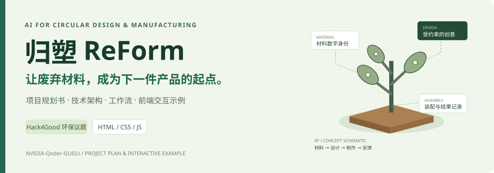

# 归塑 ReForm

本文保存归塑原始规划阶段的项目说明。当前展示站和组员阶段原型的交接说明见[仓库首页](../README.md)。

**让废弃材料，成为下一件产品的起点。**

AI 辅助循环设计与制造平台的项目规划书、技术蓝图与前端交互示例。项目围绕 **Hack4Good 技术向善 · 环保议题**，探索材料理解、创意设计、制造规划与实体反馈之间的连接。



[查看原始 HTML 规划书](project-plan.html) · [项目定位](#项目定位) · [体验交互示例](#体验交互示例) · [技术设计](#技术设计) · [研发路线](#研发路线) · [本地使用](#本地使用)

> **当前状态：项目规划书＋可运行的前端示例。** `docs/project-plan.html` 已包含章节导航、SVG 示意、数量校验、装配步骤预演、JSON 导出、代码展开与打印样式。真实 AI 服务、参数化 CAD、物理仿真、数字孪生工作站和设备接入属于后续研发范围。
>
> 仓库名称中的 NVIDIA、Qoder 用于标识赛事语境，不代表已建立官方合作或完成相关产品集成。后续参赛开发与公开发布需由团队实际使用 Qoder 完成，并补充过程凭证和 Qoder Sites 地址。当前提供规划资料与离线 HTML，尚未启用 GitHub Pages，也未提供 Qoder Sites 公网部署地址。

## 项目定位

消费品更新和生产活动持续产生废旧衣物、家具、电子与机械部件。部分物品仍保有形态、结构、材料或审美价值。将它们用于再造设计时，需要同时理解现有材料、产品用途和实际制作条件。

归塑面向循环设计师、校园创客和小型再造工坊，拟提供从材料建档到方案审阅、制作资料和反馈归档的连续工作流。长期目标是形成 AI 驱动的循环设计与制造平台，并通过归塑设计品牌开展样品制作、使用验证和需求探索。

首轮聚焦三个问题：

- **材料信息分散：** 来源、尺寸、数量、缺陷和处理历史需要统一记录。
- **设计受到现实约束：** 当前库存、连接方式和加工能力会影响方案选择。
- **经验难以复用：** 修改原因、试制问题和实际材料去向需要关联到具体版本。

公共价值落在可追溯的材料复用、可学习的再造案例和可核查的制作结果。首轮试点建议从一组来源明确、经人工检查的旧木料与金属件出发，尝试制作可拆装桌面艺术摆件；具体形态以实际材料和试制结果为准。

## 产品构思与业务闭环

完整蓝图包含五个业务阶段：

| 阶段 | 主要任务 | 关联成果 |
| --- | --- | --- |
| 材料采集网络 | 收集材料、记录来源、整理图像与人工测量 | 原始记录与证据 |
| 材料智能中心 | 辅助识别、确认属性、建立数字身份和库存 | 材料护照 |
| AI 设计工作室 | 根据用途、审美和材料条件形成候选方案 | 设计版本与部件清单 |
| 数字化制造 | 从装配预演逐步发展到工程验证与数字孪生 | 制作资料、检查与任务 |
| 产品与反馈 | 试制、记录实际用料和问题、归档使用反馈 | 作品档案与可复用经验 |

规划书进一步拆成八步执行流程：**采集 → 辅助识别与确认 → 入库 → 需求与候选设计 → 规则与人工审阅 → 制作资料 → 试制 → 反馈修订**。每一步均说明输入、输出、检查点及异常去向。

## 三个智能引擎

| 引擎 | 输入 | 规划中的输出与职责 |
| --- | --- | --- |
| **材料智能** | 照片、人工测量、来源与检测资料 | 提取可见特征，整理候选类别、材料护照和待确认项 |
| **创意智能** | 需求、库存快照、风格与允许工艺 | 形成候选方案、选材理由、材料引用与 BOM 草案 |
| **制造智能** | 设计版本、部件关系、连接及设备条件 | 组织装配步骤、检查事项、制作任务与实际反馈 |

AI 提供辅助判断和设计建议，程序核对明确规则，人工确认关键属性和实物结果。成分、污染、承载能力等需要相应测量或检测依据；数量满足只说明数量条件通过。各阶段结论保留适用范围与来源。

专业角色可围绕艺术指导、工业设计、材料、结构、制造和可持续评估组织任务。后续需分别定义输入输出、工具与审阅标准。

## 仓库内容与文档功能

`docs/project-plan.html` 将正文、样式、脚本和 SVG 放在一个文件中，无需安装前端依赖。外部参考链接需要联网，规划书主体可离线阅读。

| 章节 | 内容 |
| --- | --- |
| 01 项目定位与价值主张 | 用户、问题、公共价值和首轮验证 |
| 02 本次交付与能力边界 | 软件原型、真实案例、AI 节点与后续能力 |
| 03 端到端流程与异常处理 | 八步流程及可切换详情 |
| 04 总体技术架构 | 体验、编排、智能、数据与集成分层 |
| 05 三个智能引擎与人工复核 | 输入输出、规则和审阅职责 |
| 06 数据模型与版本追踪 | 实体关联、材料护照及单位来源 |
| 07 建议接口与异步任务 | 服务契约、状态和调用时序 |
| 08 可操作示例与代码说明 | 数量校验、构型切换、装配与导出 |
| 09 工程设计与制造演进 | CAD、仿真和设备试点的进入条件 |
| 10 环保价值与长期积累 | 物料指标、证据和知识资产 |
| 11 多媒体页面与视频分镜 | 素材矩阵、90 秒分镜与媒体登记 |
| 12 研发排期、分工与阶段门槛 | 三人分工、参赛排期和演进成果 |
| 13 测试、验收与证据清单 | 技术校验链和可勾选自查项 |
| 14 参考依据与阅读方式 | 官方资料和文件使用说明 |

文档支持章节定位、代码展开与复制、窄屏横向查看技术图、打印时展开代码。交付自查勾选仅保存在当前浏览器；示例材料状态通过导出 JSON 留存。

## 体验交互示例

打开第 08 章后，可按以下路径复核：

1. 保持六片构型和库存 6 件，页面显示数量满足。
2. 将库存改为 3 件，页面显示缺少 3 件，相应部件灰显。
3. 切换三片构型，所需数量和 JSON 随之变化，缺口归零。
4. 拖动装配步骤，查看底座、支架、装饰片的示意顺序。
5. 展开当前 JSON 或导出示例档案，检查数量、构型和检查状态。

输入允许 0—99 的整数；无效输入不会更新档案。页面展示的 `checkQuantity` 函数参与实际计算：

```javascript
function checkQuantity(required, available) {
  if (![required, available].every(Number.isInteger) ||
      required < 0 || available < 0) {
    throw new RangeError("数量必须为非负整数");
  }
  const missing = Math.max(0, required - available);
  return { quantitySatisfied: missing === 0, missing };
}
```

这部分使用示例数据、两种预设构型和二维装配图；导出中将尺寸、结构和工艺检查记录为 `not_evaluated`。它验证数据关联与交互机制，未调用识别模型、CAD、求解器或真实设备。

## 技术设计

### 数据与版本

拟使用 `Material` 保存来源、单位、数量、状态及测量依据；`DesignVersion` 保存需求快照、参数和审阅结果；`DesignMaterial`、`BOMItem` 关联材料与部件；`WorkflowTask` 保存任务输入和状态；`ProductionRecord`、`Evidence` 保存实际用料、问题与凭证。

同一设计可引用多件材料，同一材料也可参与多个候选方案。变更产生新版本，清单、检查报告和试制记录锁定对应版本。计划用料与实际用料分开，库存占用与真实扣减分别处理。这些是服务端实现规划，当前 HTML 没有部署共享数据库。

### 建议服务接口

| 方法与路径 | 用途 |
| --- | --- |
| `POST /api/materials` | 创建材料档案 |
| `PATCH /api/materials/{id}` | 按预期版本更新材料 |
| `POST /api/design-jobs` | 提交材料快照、需求与工艺条件 |
| `GET /api/jobs/{id}` | 查询任务状态和错误 |
| `POST /api/designs/{id}/validate` | 执行指定设计版本的规则检查 |
| `POST /api/production-records` | 记录真实试制结果 |
| `GET /api/projects/{id}/export` | 导出项目档案及证据索引 |

上述路径为建议契约。真实 AI 由服务端适配层调用，保留输入、模型与模板版本、输出和审阅记录。任务拟区分 `queued`、`running`、`awaiting_review`、`succeeded`、`failed`、`cancelled`；生成结果与工程检查分别记录。重试避免重复扣料，过期响应不覆盖新结果，参数变更触发重新检查。

## 多媒体制作与展示

参赛网站建议准备 **1 个完整案例、8—12 张图片、1 段 60—90 秒视频、3 个动态模块、2 个代码展示区**。

- 图片覆盖材料原貌、测量制作、方案部件、成品或概念图及开发凭证。
- 视频依次说明材料、护照、库存变化、装配、结果和能力状态，提供封面、字幕与文字摘要。
- 动态模块围绕材料护照、库存约束设计台和装配步骤播放器展开。
- 代码展示区读取当前材料 JSON，并解释实际运行的规则函数。

当前规划书包含 SVG 示意与制作分镜；真实照片和视频需团队采集后加入。素材登记应保存来源、类型、关联案例、地址与制作状态，分别标识实拍、概念图、真实录屏和示例演示。

## 研发路线

| 阶段 | 目标 | 主要验收依据 |
| --- | --- | --- |
| 交互原型 | 材料护照、模板方案、规则、预演与导出 | 数据一致、缺口可解释、流程可走通 |
| AI 辅助设计 | 接通真实节点和人工评审 | 保存输入输出，记录有效建议、失败与修改 |
| 工程资料 | 参数化 CAD、适用检查和实体试制 | 可编辑几何、参数依据、审核与实物对照 |
| 数字孪生试点 | 选定工作单元的虚实映射与反馈 | 标定、状态回传、偏差分析和授权执行记录 |

早期反馈优先用于修正规则、模板与可检索案例。模型训练依赖授权、数据质量与独立评测。数字孪生阶段还需建立材料、产品、工作站和工序的对应关系，实际设备执行保留独立控制与授权。

## 环保指标与技术积累

首轮记录真实材料去向、用料、可复用余料、损耗、工时和制作问题。旧料占比可按成品中可追溯旧料质量除以成品总质量计算；不同计量单位分别统计。减碳估算需要对照情景、生命周期边界和系数来源，当前没有实测减碳成果。

长期积累包括来源清晰的材料档案、经审阅的设计与工艺知识、真实失败案例，以及贯穿材料—设计—制作—使用的关联数据。所谓壁垒应由这些资产如何取得、验证和改善后续决策来说明。

## 本地使用

GitHub 仓库页展示 HTML 源码，阅读规划书请下载后打开：

1. 点击仓库 **Code → Download ZIP** 并解压，或克隆仓库。
2. 用现代浏览器打开根目录的 `docs/project-plan.html`。
3. 使用侧栏导航阅读；点击“打印规划书”可进入浏览器打印界面。

也可在仓库目录启动静态服务：

```bash
git clone https://github.com/ThreshoLdnnis/NVIDIA-Qoder-GUISU.git
cd NVIDIA-Qoder-GUISU
python -m http.server 8000
```

随后访问 `http://localhost:8000/docs/project-plan.html`。该命令只提供本地静态预览，真实 AI 与后端服务需要另行实现。

## 团队协作与验证

建议三人分别负责产品与实物证据、交互与数据、视觉媒体与集成。规划书列出 2026 年 11 月 25—30 日的执行安排；团队按实际进度更新，保留 Qoder 开发、修改、调试、发布和提交记录。

验收覆盖库存充足、不足、无效输入、构型切换、JSON 一致性、导出、移动端阅读和公开媒体访问。实体结论需有对应测量、制作与检查记录；自查勾选供团队管理进度，不能代替测试证据。

## 参考资料

- [天池官方赛题页](https://s.tianchi.aliyun.com/competition/entrance/532536/introduction)：参赛与提交要求。
- [Qoder Sites 文档](https://docs.qoder.com/qoder/sites)：创建、预览、发布与访问范围。
- [NVIDIA 数字孪生说明](https://www.nvidia.com/en-us/glossary/digital-twin/)：虚拟模型、物理对象与数据关系。
- [MDN HTML video](https://developer.mozilla.org/en-US/docs/Web/HTML/Reference/Elements/video)：视频实施参考。
- [MDN 减少动态效果](https://developer.mozilla.org/en-US/docs/Web/CSS/Reference/At-rules/@media/prefers-reduced-motion)：动效适配。

## English summary

ReForm explores AI-assisted circular design and manufacturing, starting from available reclaimed materials. This repository contains a self-contained HTML project plan and a working frontend demonstration of quantity constraints, assembly visualization and JSON export. AI services, engineering CAD, physical simulation and equipment integration remain planned research stages.
